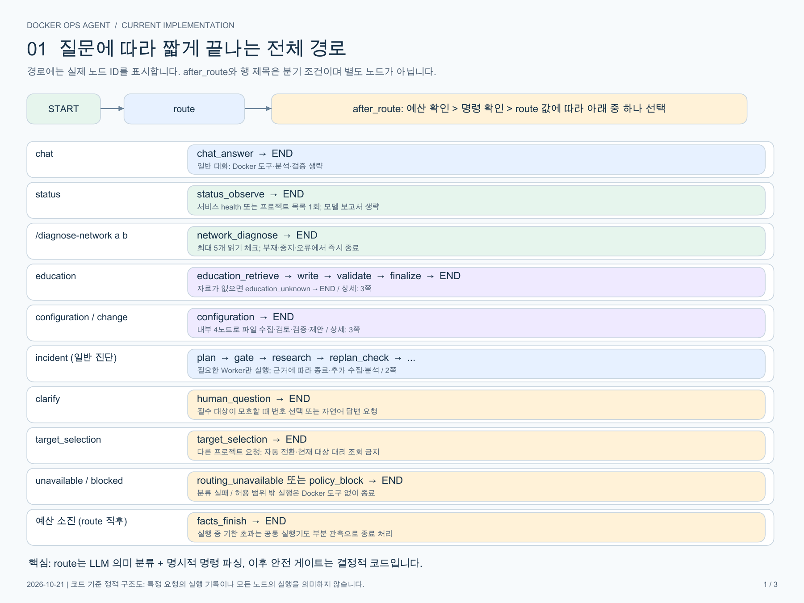

# Docker Ops Agent

자연어로 Docker 상태와 Compose/Dockerfile을 점검하는 교육·진단 미니프로젝트입니다. FastAPI, LangGraph, MCP, Ollama/OpenAI, Vue를 사용합니다. 필요한 경로만 실행하며 화면에는 실제로 시작한 노드만 표시합니다.

2026-10-22 업데이트: [시연 질문 10개 실제 실행·수정 결과](docs/DEMO_QUESTIONS_VERIFICATION_20261022.md), [현재 구성 조회](docs/CONFIGURATION_LOOKUP_FIX.md), [실행 요청·파일 검토 분리](docs/INTENT_FULFILLMENT_FIX.md), [UI/UX 개선](docs/UI_UX_IMPROVEMENTS.md). 현재 값 조회를 교육·최적화 검토와 분리하고, 명시된 서비스 대신 다른 서비스를 조회하지 않도록 인자를 검증합니다. 아래 PDF는 이전 구조의 기록이며 최신 inventory/runtime_action/port_diagnose 분기는 위 문서를 우선하세요.



## 구조와 설명

- [LangGraph 상세 설명: 요청별 경로·노드 입출력·조건과 14개 구현 항목](docs/CURRENT_LANGGRAPH_GUIDE.md)
- [LangGraph 흐름도 PDF: 전체 분기 / 장애 진단 / 실행 인프라](output/pdf/current_langgraph.pdf)
- [최신 실행 정책: 호출 예산·모델 역할·병렬화·LangSmith](docs/OPTIMIZATION_IMPLEMENTATION.md)
- [근거·상태·설정 검증 계약](docs/RELIABILITY_CONTRACT.md)
- [SQLite 체크포인터와 대화 기억](docs/CONVERSATION_MEMORY.md)
- [조건부 사람 질문](docs/HUMAN_CLARIFICATION.md), [프로젝트 선택](docs/PROJECT_SELECTION.md)
- [설정 검토·변경 승인 범위](docs/CONFIGURATION_WORKFLOW.md), [알려진 한계](docs/LIMITATIONS.md)

## 주요 흐름

| 질문 종류 | 실제 실행 |
|---|---|
| 일반 대화 | LLM 라우팅 → 직접 답변 |
| 상태 조회 | 라우팅 → 구조화 상태 조회 1회 → 종료 |
| 현재 이미지·마운트·설정·사용량 | lookup 필드 분류 → inventory_observe → 실제 컨테이너/Compose 선언 분리 조회 → 종료 |
| 호스트 포트 점유 조회 | 모델이 port_owners 선택 → port_diagnose → Engine 게시 포트 조회. 점유 확인 없는 중지·전체 재시작 승인 없음 |
| 기존 컨테이너 시작·중지·재시작 | runtime_action → 정확한 서비스·명령·컨테이너 ID의 미리보기 → 개별 1회 승인 |
| `/diagnose-network <a> <b>` | 명령 파싱 → 제한된 네트워크 체크리스트. 모델 호출 없음 |
| Docker 개념 교육 | 의미 기반 카드 선택 → 로컬 자료 검색 → 검토 원문 조립 → 코드 검증 |
| 장애 진단 | Supervisor 계획 → 안전 게이트 → 필요한 Worker 병렬 관측 → 근거 검토 → 조건부 분석·보고서·검증 |
| Compose/Dockerfile 검토 | 실제 파일 수집 → 모델 후보 → 스냅샷 기반 정적 주장 검증 → 결과·조건부 제안 |
| 대상이 모호함 / 다른 프로젝트 | 번호·자연어 확인 질문 / 명시적 프로젝트 선택 요청 |

읽기 진단은 변경하지 않습니다. 설정 변경은 정확한 diff의 파일 승인과 별도의 배포 승인을 구분합니다. 현재 자동 설정 수정안의 초기 지원 범위는 관측상 누락된 `.dockerignore` 추가이며, 임의의 Dockerfile/Compose 수정을 자동 승인하지 않습니다.

CPU/메모리 **현재 사용량**과 **제한 설정**은 별개입니다. 중지 상태에서는 현재 사용량을 0으로 추정하지 않으며 종료 당시 메모리 시계열 저장은 없습니다. 이미지 크기는 컨테이너의 immutable image ID를 inspect하고, 현재 Dockerfile의 FROM 선언과 실제 빌드 베이스 확인 여부를 구분합니다. Compose 보안 설정의 미지정을 취약점이나 이미지 root 실행의 증명으로 취급하지 않습니다.

Health Check/depends_on 임의 자동 패치·후속 재시작, 포트 점유자 자동 종료 후 새 데모 생성/연쇄 배포는 아직 지원하지 않습니다. 기존 서비스의 승인된 start/stop/restart와 혼동하지 마세요.

## 로컬 실행: Ollama

Python 3.11+, Node.js 22.12+, Docker Engine/Desktop와 Compose, Ollama가 필요합니다. Docker와 Ollama를 먼저 시작하세요.

```bash
git clone https://github.com/Jkzzmn/docker-ops-agent.git
cd docker-ops-agent
./setup.sh
cp .env.example .env
ollama pull qwen3:4b-instruct
ollama pull qwen3:8b
./run_ollama.sh
```

화면: http://127.0.0.1:5173 / API: http://127.0.0.1:8100

의도·교육 자료 의미 선택에는 QUALITY 모델을, 별도 대상 추출에는 OLLAMA_ROUTER_MODEL(미지정 시 fast)을 사용합니다. 기본 fast/router는 qwen3:4b-instruct, quality는 qwen3:8b입니다. 명시된 이름·포트 검사는 의도 분류가 아닌 안전 경계이며, Backend/DB 역할명을 api/postgres 등으로 자동 변환하지 않습니다.

여러 Compose 프로젝트가 있으면 UI에서 프로젝트 또는 접근 가능한 Compose 폴더를 선택합니다. 필요하면 `.env`에 `DOCKER_PROJECT_DIR`, `COMPOSE_PROJECT_NAME`, `DOCKER_ALLOWED_SERVICES`를 지정하세요. 다른 컴퓨터에서는 그 컴퓨터의 Docker context와 프로젝트 경로를 선택해야 합니다. 임의 원격 PC의 파일을 자동 수집하는 구조가 아닙니다.

```text
ai 상태만 알려주세요
현재 선택한 프로젝트의 Compose와 Dockerfile을 읽고 오류·비효율을 검토해주세요. 변경하지 마세요.
컨테이너를 삭제하고 새로 만들면 업로드 파일이 왜 사라질 수 있나요?
/diagnose-network backend postgres
```

서비스명은 선택한 프로젝트에 맞게 바꾸세요. 컨테이너가 없거나 중지돼 있으면 DNS/TCP 검사를 강제로 진행하지 않습니다. 데모 프로젝트는 [demo_stack](demo_stack/README.md)에 있습니다. 테스트용 double은 회귀 검증용이며 실서비스의 가짜 응답 모드가 아닙니다.

## OpenAI 및 LangSmith

OpenAI를 사용하려면 로컬 `.env`에 `OPENAI_API_KEY`를 설정하고 `./run_openai.sh`를 실행합니다. 키를 저장소에 올리지 마세요. 역할별 모델은 환경변수로 설정할 수 있습니다.

LangSmith는 `LANGSMITH_TRACING=true`와 `LANGSMITH_API_KEY`가 모두 있을 때만 켜집니다. 원문 질문·로그·파일·도구 인자를 보내지 않는 메타데이터 전용 추적입니다. 실제 클라우드 수신 확인은 계정 키 없이 수행하지 않았습니다.

기본 실행 상한은 요청 60초, 모델 8회, 도구 24회, 추가 수집 2회, 검증 1회입니다. 읽기 동시성은 4, 모델 동시성은 1입니다. 근거 부족·예산 소진·검증 거절 시 미검증 결론 대신 확인 가능한 관측과 한계를 표시합니다.

## 테스트

```bash
.venv/bin/python -m pytest -q
node --test frontend/tests/*.test.mjs
npm --prefix frontend run build
docker compose --project-directory demo_stack config --quiet
# 실제 로컬 모델·선택 Docker 대상으로 실행, 변경 승인은 실행하지 않음
.venv/bin/python -m eval.demo_questions_live
```

최신 로컬 회귀는 백엔드 397개, 프론트 10개와 production build 통과입니다. 실제 Ollama/Docker 원문 10개는 요청·답변 계약 10/10 통과이며, Backend/DB가 없는 현재 평가 프로젝트에서는 5개가 올바른 대상 확인으로 종료됐습니다. 이를 실제 장애 10개 재현·자동 복구 성공으로 표현하지 않습니다. 공개용 사본에서도 자동 회귀와 build를 확인하며, CI는 실제 개인 Docker 환경과 유료 모델 호출을 재현하지 않습니다.

## 공개 범위와 보안

이 저장소는 로컬 개발 원본의 공개용 사본입니다. `.env`, API 키, SQLite 대화·체크포인트·승인 DB, 원시 모델 입출력·실행 결과, 개인 환경 스크린샷, 의존성·캐시는 포함하지 않았습니다. 문서의 개인 절대 경로는 예시 경로로 바꾸고 저장소 내부 링크는 상대 경로로 변환했습니다. 문서에 남아 있는 `eval/results/...`는 비공개 원시 실험 기록의 참조이며 이 저장소에서는 열리지 않을 수 있습니다. 원시 덤프를 포함한 이전 README 대신 이 공개용 안내를 제공합니다.

교육 검색은 검토된 로컬 카드 5개의 검색이며 벡터 DB나 자동 웹 검색이 아닙니다. 체크포인터와 메시지 이력은 별개이고, 사람 응답은 현재 LangGraph interrupt/resume 대신 별도 저장소·API를 사용합니다. 운영용 인증·분산 실행·다중 사용자 보안은 완성된 상태가 아니므로 로컬 학습·과제용으로 사용하세요. 파일 변경·컨테이너 작업을 승인하기 전에 대상과 diff를 직접 확인하세요.
